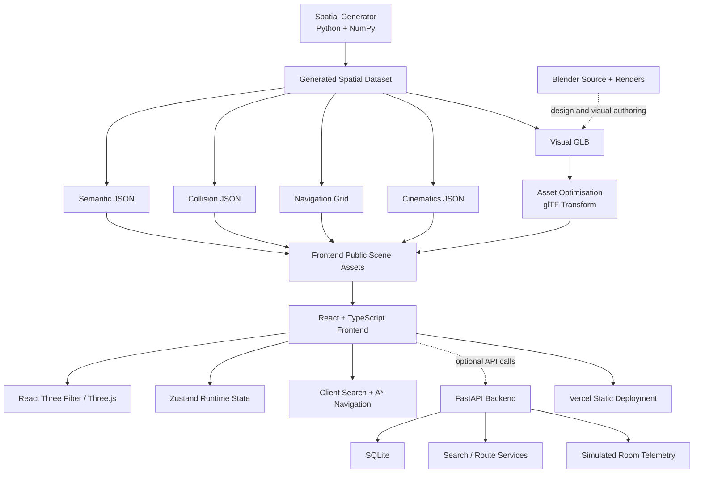

<div align="center">

# 🏡 NAMMA LUXE TWIN — HOUSE 01

### An Interactive, Semantic, Multi-Floor Digital Twin of a Contemporary Indian Townhouse

**TECHFEST IIT BOMBAY 2026–27 · NAMMA SPACE**  
**TEAM TWOPOINTERS**

[🌐 Live House Twin](https://namma-project-sable.vercel.app/) · [💻 Source Repository](https://github.com/tejaswee-06/Namma_Space)


*Explore the house as geometry. Understand it as structured space. Move through it with constraints.*

</div>

---

# 📌 Table of Contents

- [Competition](#-competition)
- [The Problem](#-the-problem)
- [Our Solution](#-our-solution)
- [Core Engineering Principle](#-core-engineering-principle)
- [Live Product](#-live-product)
- [House 01 at a Glance](#-house-01-at-a-glance)
- [The Interactive Experience](#-the-interactive-experience)
- [Spatial Search and Discovery](#-spatial-search-and-discovery)
- [Multi-Floor Navigation](#-multi-floor-navigation)
- [Smart-Home Interaction Layer](#-smart-home-interaction-layer)
- [Lighting and Environment](#-lighting-and-environment)
- [Cinematic and Dollhouse Modes](#-cinematic-and-dollhouse-modes)
- [System Architecture](#-system-architecture)
- [Spatial Data Model](#-spatial-data-model)
- [Navigation Architecture](#-navigation-architecture)
- [Backend and API](#-backend-and-api)
- [Room Telemetry](#-room-telemetry)
- [Blender and Architectural Deliverables](#-blender-and-architectural-deliverables)
- [Technology Stack](#-technology-stack)
- [Getting Started](#-getting-started)
- [Testing and Validation](#-testing-and-validation)
- [Repository Structure](#-repository-structure)
- [Deployment](#-deployment)
- [End-to-End Demo Workflow](#-end-to-end-demo-workflow)
- [What Makes NAMMA LUXE TWIN Different](#-what-makes-namma-luxe-twin-different)
- [Provenance, Scope, and Limitations](#-provenance-scope-and-limitations)
- [Roadmap](#-roadmap)
- [Team](#-team)

---

# 🏆 Competition

## TECHFEST IIT BOMBAY — NAMMA SPACE 2026–27

**Project:** NAMMA LUXE TWIN — HOUSE 01  
**Team:** TWOPOINTERS  
**Track:** Indoor Spatial Digital Twin  
**Institution:** Thadomal Shahani Engineering College, Mumbai

### Team Members

- **Tejaswee Rajput** — Team Lead
- **Sohana Pilli** — Team Member
- **Rahul Sharma** — Team Member

---

# 🚨 The Problem

Indoor environments are difficult to understand remotely when information is fragmented across photographs, static floor plans, room labels, and verbal directions.

A photograph communicates appearance, but not traversable connectivity. A floor plan communicates layout, but not an immersive view of the space. A room label identifies a destination, but does not explain how a person can reach it.

A useful indoor digital twin must bring these representations together while preserving their distinct responsibilities.

The engineering challenge has several coupled dimensions:

- **Visual representation:** constructing a coherent 3D scene that can be inspected from multiple viewpoints.
- **Spatial semantics:** associating rooms, furniture, fixtures, doors, and points of interest with stable identities and coordinates.
- **Walkability:** distinguishing navigable floor regions from walls, glazing, furniture, rails, gates, and other obstacles.
- **Multi-floor connectivity:** representing vertical circulation explicitly rather than treating floors as disconnected images.
- **Interaction:** supporting search, inspection, guided routes, and direct first-person movement in a browser.
- **Stateful scene controls:** allowing selected architectural and smart-home elements to respond to user interaction.

For a capture-derived digital twin, further challenges arise from incomplete image coverage, blur, occlusion, reflective surfaces, camera-registration errors, metric-scale ambiguity, and gravity-alignment drift.

**The problem is therefore not merely rendering a house in 3D. It is maintaining consistency between visual geometry, semantic information, and navigable space.**

---

# 💡 Our Solution

**NAMMA LUXE TWIN — HOUSE 01** is a browser-based, interactive digital-twin prototype built around a contemporary G+1 Indian townhouse.

The product combines a detailed 3D house model with structured room and object metadata, floor-aware navigation, natural-language-style spatial search, interactive scene controls, and a dedicated API layer.

The application is organised around five product capabilities:

- 🏡 **Immersive house inspection** — orbit, first-person, cinematic, and dollhouse views.
- 🔎 **Semantic spatial discovery** — find rooms and objects using names, categories, and synonym-aware queries.
- 🧭 **Obstacle-aware guidance** — calculate routes over per-floor walkability grids and explicit stair connectivity.
- 💡 **Interactive home controls** — operate scene lights, fans, curtains, doors, and sliders in the rendered model.
- 📐 **Architectural information** — inspect floor plans, room dimensions, object positions, drawings, and schedules.

The experience is divided into two cooperating parts:

```text
                         NAMMA LUXE TWIN
                                │
                ┌───────────────┴───────────────┐
                │                               │
                ▼                               ▼
        INTERACTIVE HOUSE                 SPATIAL SERVICES
          EXPERIENCE                    AND DATA LAYER
                │                               │
      ┌─────────┼─────────┐           ┌─────────┼─────────┐
      │         │         │           │         │         │
      ▼         ▼         ▼           ▼         ▼         ▼
    Inspect   Search   Navigate     Rooms     Routes   Telemetry
      │         │         │           │         │         │
      └─────────┴─────────┘           └─────────┴─────────┘
                │                               │
                └───────────────┬───────────────┘
                                ▼
                       STRUCTURED HOUSE TWIN
```

**Provenance:** HOUSE 01 is a procedurally designed synthetic environment generated from Python geometry and Blender workflows. It is not a photogrammetric reconstruction of an occupied home. The interface displays this provenance explicitly.

---

# 🎯 Core Engineering Principle

NAMMA LUXE TWIN does not treat the rendered mesh as the entire digital twin.

Instead, the house is represented through independently generated but spatially aligned data layers:

```text
VISUAL GEOMETRY
      │
      ├── GLB scene and materials
      │
      ▼
SEMANTIC STRUCTURE
      │
      ├── Floors, rooms, objects, doors, lights
      │
      ▼
NAVIGATION STRUCTURE
      │
      ├── Walkability grids, colliders, stair portal
      │
      ▼
INTERACTIVE RUNTIME
      │
      ├── Rendering, search, routes, scene controls
      │
      ▼
BROWSER DIGITAL TWIN
```

This separation supports three important properties:

1. **Independent validation:** navigation can be tested without relying on visual plausibility.
2. **Stable interaction contracts:** the viewer consumes structured scene data rather than hard-coding every room and object.
3. **Replaceable scene assets:** the rendered house can be regenerated or replaced while retaining the broader interaction architecture, provided the scene schema and coordinate conventions are preserved.

---

# 🌐 Live Product

<div align="center">

### Explore NAMMA LUXE TWIN — HOUSE 01

[](https://namma-project-sable.vercel.app/)

**Live URL:** https://namma-project-sable.vercel.app/

</div>

The deployed frontend provides the interactive 3D house experience. The bundled scene assets and spatial JSON files are loaded by the browser. The FastAPI service is a separate optional component; API-dependent telemetry is available only when that service is configured and reachable.

---

# 🏡 House 01 at a Glance

HOUSE 01 is a two-storey contemporary Indian townhouse designed around a 10.8 m × 17.2 m building envelope.

### Architectural Programme

**Ground Floor**

- Entrance foyer
- Guest bedroom
- Guest bathroom / powder room
- Storage
- Formal living room
- Dining room
- Kitchen
- Pantry
- Utility / laundry
- Rear garden / courtyard

**First Floor**

- Staircase landing and corridor
- Master bedroom
- Walk-in wardrobe
- Master bathroom
- Family lounge
- Bedroom 2
- Study / library
- Additional bathroom
- Bedroom 2 dressing area
- Front balcony

### Generated Scene Statistics

| Parameter | Value |
|---|---:|
| Building floors | 2 (Ground + First) |
| Floor-to-floor height | 3.4 m |
| Building envelope | 10.8 m × 17.2 m |
| Room records | 21 (including a facade-screen record) |
| Main spatial rooms / areas | 20 |
| Semantic objects | 213 |
| Door / gate records | 20 |
| Light anchors | 85 |
| Collision volumes | 329 |
| Stair connections | 1 portal connection |
| Scene triangle count | 350,728 |
| Optimised web GLB | approximately 6.7 MB |

These are generated scene metadata and asset statistics. They are not survey measurements of a real property.

## Exterior

<div align="center">


*Front elevation and entrance approach — generated Blender render.*

</div>

## Dollhouse View

<div align="center">


*Separated floor and roof composition for whole-house inspection.*

</div>

## Interior Views

<div align="center">


</div>

---

# 🧭 The Interactive Experience

NAMMA LUXE TWIN provides four primary viewing modes.

## 1. Orbit Mode

Orbit mode is the default inspection experience.

Users can:

- Rotate the camera around the house.
- Zoom and pan to inspect architectural details.
- Select rooms and catalogued objects.
- Focus the camera on a selected spatial entity.
- Change floor visibility and roof visibility.
- Open the floor-plan interface.

## 2. Walk Mode

Walk mode places the camera at a first-person eye position inside the house.

The runtime uses a custom collision world built from axis-aligned bounding-box (AABB) colliders.

| Input | Action |
|---|---|
| `W` | Move forward |
| `A` | Move left |
| `S` | Move backward |
| `D` | Move right |
| Mouse | Look around after pointer capture |
| `Shift` | Run |
| `E` / click | Interact with a nearby supported door or object |
| `Esc` | Release pointer capture / leave guided interaction |
| `M` | Open the plan interface |

When pointer lock is unavailable, drag-look interaction is used as a fallback.

Movement is checked against the authored wall, furniture, glass, rail, gate, and door collider set. The movement resolver attempts axis sliding when a diagonal move is blocked.

## 3. Cinematic Mode

Cinematic mode plays a sequence of predefined camera shots.

Two tour groups are provided:

- Exterior tour
- Interior tour

The user can play, pause, move between shots, and inspect the scene through authored camera positions and look targets.

## 4. Dollhouse Mode

Dollhouse mode exposes the building's internal organisation by animating floor and room separation.

It provides:

- Floor separation control.
- Room explosion control.
- Roof elevation.
- Reassembly into the normal house configuration.

This mode is intended for architectural inspection and spatial explanation rather than navigation.

---

# 🔎 Spatial Search and Discovery

The search system allows users to locate rooms and objects without manually expanding the entire house hierarchy.

Search is implemented through deterministic token parsing, synonym expansion, and relevance scoring. It is not an LLM-based conversational service.

## Supported Query Patterns

| Query | Intent |
|---|---|
| `Find the chandelier` | Find a matching object |
| `Where is the fireplace` | Locate a named object |
| `Take me to the master bedroom` | Resolve a destination and request a route |
| `Find the nearest bathroom` | Rank matching destinations by route distance |
| `Find all lighting devices` | Return matching objects as a group |
| `Take me to the study` | Route to a room destination |

## Search Pipeline

```text
USER QUERY
    │
    ▼
TOKEN NORMALISATION
    │
    ▼
INTENT CLASSIFICATION
    │
    ├── FIND
    ├── GOTO
    ├── NEAREST
    └── ALL
    │
    ▼
SYNONYM EXPANSION
    │
    ▼
ROOM + OBJECT MATCHING
    │
    ▼
RELEVANCE SCORING
    │
    ▼
RESULTS
    │
    ├── Focus and highlight
    ├── Select entity
    └── Navigate to destination
```

## Semantic Search Features

- Room names and room categories.
- Object names and object categories.
- Keyword matching.
- Synonym expansion for common terms.
- Nearest-result selection using calculated route distance.
- Multi-object result highlighting.
- Camera focus on selected rooms and objects.

Example synonym families include:

- `toilet` ↔ bathroom / washroom / WC / powder room
- `couch` ↔ sofa
- `fridge` ↔ refrigerator
- `lights` ↔ lighting / lamps / chandelier / pendant
- `stairs` ↔ staircase
- `drapes` ↔ curtains

Search is deterministic and data-grounded: the system only returns entities represented in the current semantic dataset.

---

# 🗺️ Multi-Floor Navigation

A rendered house is not automatically a navigable house.

NAMMA LUXE TWIN maintains a separate navigation grid and collision model so routes are generated from walkability constraints rather than from visual mesh appearance.

## Navigation Model

- Per-floor walkability grids.
- Grid cell resolution: 0.1 m.
- Agent radius: 0.25 m.
- Eight-connected A* search.
- Diagonal movement only when both adjacent orthogonal cells are walkable.
- Explicit stair portal between ground and first floor.
- Line-of-sight route smoothing.
- Independent segment validation against blocking AABBs.

## Route Computation

A* evaluates candidate cells using:

\[
f(n)=g(n)+h(n)
\]

Where:

- `g(n)` is the accumulated route cost from the start.
- `h(n)` is the estimated remaining cost to the destination.
- `f(n)` is the total estimated cost of the candidate node.

The implementation uses cardinal and diagonal edge weights and incorporates the explicit portal connection for inter-floor movement.

## Navigation Pipeline

```text
START LOCATION + DESTINATION
              │
              ▼
      RESOLVE ROOM / OBJECT
              │
              ▼
       MAP TO GRID CELLS
              │
              ▼
       CHECK WALKABILITY
              │
              ▼
       8-CONNECTED A* SEARCH
              │
              ├── Same-floor neighbours
              │
              └── Stair portal transition
              │
              ▼
       RECONSTRUCT PATH
              │
              ▼
       LINE-OF-SIGHT SMOOTHING
              │
              ▼
       COLLIDER VALIDATION
              │
              ▼
       ROUTE RESULT / NO-PATH
```

## Route Interaction

When a route is found, the interface displays:

- Start and destination labels.
- Estimated route distance.
- Approximate walk duration derived from a fixed nominal speed.
- Floor-transition information.
- Ordered room transitions.
- A route polyline on the mini-map / plan view.
- A **Walk it** action to enter guided route mode.

The user can also choose start and end locations directly from the floor-plan interface.

## Collision Behaviour

The authored collision model treats the following categories as blocking geometry:

- Walls
- Furniture
- Glass
- Rails
- Gates
- Closed doors

Door state can change the corresponding runtime collision state. The movement controller uses a custom AABB-based collision and sliding resolver; it does not use Rapier or a physics-engine character controller.

The route validator provides an additional software check against raw blocker bounds. This is validation on the designed scene, not a physical safety certification.

---

# 💡 Smart-Home Interaction Layer

The Smart Home panel exposes controls that change supported elements in the rendered house.

These controls are **visual scene simulations**. They are not connected to physical appliances, home-automation hubs, or installed IoT devices.

## Lighting Groups

The light system contains 85 authored light anchors divided into eight groups:

- Chandeliers
- Pendants
- Wall sconces
- Table and floor lamps
- Cove lighting
- Downlights
- Task lighting
- Exterior and garden lighting

Users can:

- Toggle individual lighting groups.
- Turn all supported lighting groups on or off.
- Adjust overall brightness.
- Adjust ambient intensity.
- Change the time-of-day environment.

The runtime uses a bounded pool of actual point lights and assigns the nearest enabled light anchors to that pool. The number of active point lights depends on the selected quality mode.

## Fans

Four fan objects are catalogued in the current semantic dataset.

Each fan supports four simulated states:

- Off
- Speed 1
- Speed 2
- Speed 3

The selected state changes the rendered fan rotor animation.

## Curtains

Curtain controls change the scale and visual position of the curtain panels to represent open and closed states.

## Doors and Sliding Panels

The interface supports opening and closing authored doors and sliders, including bulk open-all and close-all actions.

The rendered geometry responds to the selected state. Supported door and gate states are also considered by the runtime collision world.

## Cabinets and Drawers

Supported cabinet doors and drawers can be interacted with directly in the 3D scene. Their node transforms animate between the authored closed and open positions.

---

# 🌤️ Lighting and Environment

The environment system provides three scene presets:

| Preset | Description |
|---|---|
| Day | Daylight environment with blue sky and neutral illumination |
| Golden | Warm, low-angle sunlight and warmer environment colours |
| Night | Dark environment with stars and a cool, low-intensity sky |

Two rendering-quality modes are available:

### Interactive

- Lower device-pixel ratio.
- Reduced live-light pool.
- No presentation post-processing stack.
- Intended for responsive interaction.

### Presentation

- Shadow rendering.
- Increased live-light pool.
- Higher device-pixel ratio where available.
- SMAA anti-aliasing.
- Bloom.
- Vignette.

The system measures and displays a client-side FPS estimate. No cross-device GPU performance benchmark is claimed in this repository.

---

# 🎬 Cinematic and Dollhouse Modes

## Cinematic Tours

Camera keyframes are stored in `cinematics.json` and grouped into exterior and interior sequences.

The cinematic controller interpolates camera position, look direction, and field of view between authored shots.

## Dollhouse Decomposition

The dollhouse controller animates:

- First-floor elevation.
- Roof elevation.
- Room-level horizontal separation.

This provides a visual explanation of the house's overall organisation and allows interior components to be inspected without navigating through the building.

---

# 🏗️ System Architecture

The application is divided into four major engineering domains:

1. **Procedural scene generation** — Python and NumPy geometry generation, semantic extraction, collider construction, and navigation-grid creation.
2. **3D asset production** — GLB export, web optimisation, and Blender scene authoring.
3. **Interactive frontend** — React, TypeScript, React Three Fiber, Three.js, and Zustand.
4. **Spatial backend** — FastAPI and SQLite endpoints for semantic queries, routes, device-state storage, and simulated room telemetry.

## High-Level Architecture



## Runtime Data Flow

```text
                    GENERATED HOUSE DATA
                             │
             ┌───────────────┼───────────────┐
             │               │               │
             ▼               ▼               ▼
          HOUSE GLB      SEMANTIC JSON   COLLISION / NAV
             │               │               │
             └───────────────┼───────────────┘
                             │
                             ▼
                    FRONTEND DATA LOADER
                             │
                 ┌───────────┴───────────┐
                 │                       │
                 ▼                       ▼
            3D SCENE                SPATIAL RUNTIME
                 │                       │
                 ▼              ┌────────┼────────┐
             RENDERING           ▼        ▼        ▼
                              SEARCH   ROUTING  CONTROLS
                 │              │        │        │
                 └──────────────┴────────┴────────┘
                                │
                                ▼
                         BROWSER EXPERIENCE
```

---

# 🧩 Spatial Data Model

The generated semantic dataset contains the entities required by the interactive viewer.

## Floors

Each floor has a stable identifier, elevation, floor index, and associated room identifiers.

## Rooms

Room records contain:

- Stable room ID.
- House and floor identifiers.
- Name, category, and kind.
- Search keywords.
- Dimensions and area.
- Centre and bounding box.
- Clear walkable rectangle.
- Polygon boundary.
- Navigable area and agent radius.
- Connected-room relationships.
- Object count.
- Wall, floor, and ceiling material references.

## Objects

Object records contain:

- Stable object ID.
- Scene node reference.
- Name and category.
- Room and floor association.
- Position and centre.
- Rotation.
- Dimensions and bounding box.
- Search keywords.
- Solid / non-solid classification.
- Optional smart-device metadata.

## Doors and Lights

Door records describe connected rooms, opening state, type, width, and centre position.

Light records describe type, colour, intensity, distance, shadow settings, group, position, and target data.

## Spatial Coordinate Convention

| Convention | Value |
|---|---|
| Linear units | Metres |
| Up axis | Y |
| Floor 0 elevation | 0.0 m |
| Floor 1 elevation | 3.4 m |
| Street direction | −Z |
| Garden direction | +Z |
| Floor-to-floor interval | 3.4 m |

All generated spatial assets are expected to use a consistent coordinate frame.

---

# 🧭 Navigation Architecture

The navigation implementation is available in both the frontend and backend code paths.

| Component | Responsibility |
|---|---|
| `navgrid.json` | Encodes walkable cells for each floor and portal links |
| `frontend/src/lib/nav.ts` | Browser-side multi-floor A* implementation |
| `spatial/luxe/nav.py` | Python navigation generator / route implementation |
| `backend/app/luxe_nav/nav.py` | Backend route service |
| `frontend/src/lib/collision.ts` | Runtime collision and movement resolution |
| `frontend/src/lib/actions.ts` | Search-to-focus and route orchestration |

## Why Separate Navigation from Rendering?

A visual mesh may contain decorative, transparent, or non-traversable geometry. A visually open region may still be blocked by furniture or a rail, while a door may become traversable only when opened.

A separate navigation representation permits route behaviour to be evaluated as a spatial problem instead of inferred from the rendered appearance.

---

# 🔌 Backend and API

The backend is a FastAPI service with SQLite-backed state tables.

The browser application also supports client-side search and route computation using the bundled spatial dataset. The backend is therefore an additional service layer rather than a prerequisite for loading the house viewer.

## API Endpoints

### Health and Scene

| Method | Endpoint | Purpose |
|---|---|---|
| `GET` | `/api/health` | Service status, scene provenance and counts |
| `GET` | `/api/scene` | Scene metadata, floors, and entity counts |
| `GET` | `/api/semantic` | Full semantic dataset |

### Rooms and Objects

| Method | Endpoint | Purpose |
|---|---|---|
| `GET` | `/api/rooms` | List rooms; optional `floor` filter |
| `GET` | `/api/rooms/{room_id}` | Room detail and associated objects |
| `GET` | `/api/objects` | List objects; optional category, room, and floor filters |
| `GET` | `/api/objects/{obj_id}` | Object detail |
| `GET` | `/api/doors` | Door definitions |
| `GET` | `/api/lights` | Light-anchor definitions |

### Search and Navigation

| Method | Endpoint | Purpose |
|---|---|---|
| `GET` | `/api/search?q=` | Semantic room and object search |
| `POST` | `/api/route` | Route calculation and collider validation |

Example route request:

```json
{
  "from_floor": 0,
  "from_x": 4.8,
  "from_z": -4.5,
  "to_id": "ff-master-bedroom"
}
```

The route API accepts source and destination IDs or explicit coordinates and floor values. A successful response includes route waypoints, distance, room transitions, floor changes, and validation violations.

### Device State and Telemetry

| Method | Endpoint | Purpose |
|---|---|---|
| `GET` | `/api/devices` | Read stored device states |
| `PUT` | `/api/devices/{device_id}` | Store a device-state payload in SQLite |
| `GET` | `/api/telemetry` | Return generated telemetry for rooms |
| `GET` | `/api/telemetry/{room_id}` | Return generated telemetry for one room |

Example device-state payload:

```json
{
  "kind": "light",
  "state": {
    "on": false
  }
}
```

**Integration boundary:** the current Smart Home controls manipulate the rendered scene through the frontend state store. The backend exposes device-state endpoints for API clients, but the current frontend controls do not synchronise their state to physical hardware or an external home-automation platform.

---

# 📡 Room Telemetry

When the API is available, the Smart Home panel can display room-level telemetry values.

The current backend generates these values synthetically; they are not readings from installed sensors.

The telemetry model includes:

- Temperature (°C)
- Relative humidity (%)
- CO₂ concentration (ppm)
- Occupancy state
- Power estimate (W)
- Illuminance estimate (lux)

The endpoint returns a `simulated: true` flag to distinguish generated values from physical sensor data.

This layer provides a clear integration point for future environmental sensor systems without misrepresenting the current prototype as a live smart-home installation.

---

# 🎨 Blender and Architectural Deliverables

The repository includes an editable Blender project and architectural documentation.

## Blender Source

- `blender/NAMMA_LUXE_HOUSE_01.blend` — editable house scene.
- `blender/build_blend.py` — imports the source GLB and builds collections, cameras, lights, animation actions, and metadata.
- `blender/render_all.py` — renders the predefined exterior, dollhouse, and room-camera set.
- `blender/quick_preview.py` — lightweight preview utility.

The included Blender scene contains authored collections for architecture, furniture, lighting, smart devices, landscape, cameras, and animation rigs.

## Architectural Drawings

The project includes SVG drawings such as:

- Site plan.
- Ground-floor plan.
- First-floor plan.
- Furniture plans.
- Front elevation.
- Rear elevation.
- Right elevation.
- Section A–A.

## Schedules

CSV schedules are included for:

- Rooms.
- Furniture.
- Materials.
- Doors and windows.

These files provide a tabular companion to the generated spatial model.

---

# ⚙️ Technology Stack

## Frontend

- React 18
- TypeScript 5
- Vite 5
- React Three Fiber 8
- Three.js 0.169
- React Three Drei
- React Three Postprocessing
- Zustand
- Tailwind CSS 3

## Backend

- Python 3.10+
- FastAPI
- Uvicorn
- Pydantic 2
- SQLite
- NumPy

## Geometry and 3D Production

- Python / NumPy procedural geometry
- glTF / GLB
- glTF Transform CLI
- Blender Python API (`bpy`)
- Cycles rendering

## Spatial Algorithms

- Eight-connected A*
- Grid-based walkability
- Portal graph for floor transitions
- Line-of-sight smoothing
- AABB collision checks
- Deterministic synonym-aware semantic search

## Deployment

- Vercel for the frontend
- Render configuration for the optional API service

---

# 🚀 Getting Started

## Prerequisites

Install the following before running the complete local application:

- Node.js 18 or later.
- npm.
- Python 3.10 or later.
- Git (for cloning the repository).

Blender is **not required** to run the prebuilt web twin. It is required only for Blender-specific editing and rendering tasks.

## 1. Clone the Repository

```bash
git clone https://github.com/tejaswee-06/Namma_Space.git
cd Namma_Space
```

> If HOUSE 01 is stored in a subdirectory of the repository, change into the directory that contains `INSTALL.bat`, `START.bat`, `frontend/`, `backend/`, and `spatial/` before continuing.

## 2. Windows Quick Start

The project includes two convenience scripts.

1. Double-click `INSTALL.bat` to create the backend virtual environment, install Python requirements, and install frontend npm dependencies.
2. Double-click `START.bat` to start the API and Vite development server.
3. The web application opens at `http://127.0.0.1:5173`.
4. The API is available at `http://127.0.0.1:8000`.
5. Double-click `STOP.bat` to stop the processes started by this project.

The prebuilt GLB and JSON scene assets are already bundled, so Blender is not needed for normal viewing.

## 3. Manual Backend Setup

Open a terminal in the project root:

```bash
cd backend
python -m venv .venv
```

### Windows PowerShell

```powershell
.\.venv\Scripts\Activate.ps1
```

### macOS / Linux

```bash
source .venv/bin/activate
```

Install backend dependencies:

```bash
python -m pip install --upgrade pip
pip install -r requirements.txt
```

Start FastAPI:

```bash
python -m uvicorn app.main:app --reload --host 127.0.0.1 --port 8000
```

API base URL:

```text
http://127.0.0.1:8000
```

API health check:

```text
http://127.0.0.1:8000/api/health
```

## 4. Manual Frontend Setup

Open a second terminal in the project root:

```bash
cd frontend
npm install
npm run dev
```

Open:

```text
http://127.0.0.1:5173
```

The Vite development server proxies `/api` requests to `http://127.0.0.1:8000` by default. The frontend can still load the bundled scene and perform client-side search and route calculations if the backend is unavailable.

## 5. Production Frontend Build

From the `frontend/` directory:

```bash
npm run build
```

Preview the production build locally:

```bash
npm run preview
```

## 6. Environment Configuration

The repository provides `.env.example` files for local and deployment configuration.

Important variables include:

| Variable | Purpose |
|---|---|
| `VITE_API_URL` | Public base URL of the FastAPI service for the frontend |
| `VITE_PROXY_TARGET` | Local Vite proxy target; defaults to `http://127.0.0.1:8000` |
| `CORS_ORIGINS` | Explicit browser origins allowed by FastAPI |
| `CORS_ORIGIN_REGEX` | Optional regular-expression origin allowance |
| `DB_PATH` | SQLite database path |
| `DATA_DIR` | Optional directory containing semantic, collider, and navgrid JSON files |

For local development, the Vite proxy is sufficient when the backend is running on port 8000.

For a deployed frontend, set `VITE_API_URL` to the actual deployed API origin and configure the API's CORS settings to allow the frontend domain.

---

# 🧪 Testing and Validation

The repository includes Python and frontend test suites.

## Python Tests

Run from the project root:

```bash
python -m pytest tests -q
```

The recorded test report documents **12 passed** for generator data, navigation connectivity, route validation, semantic search, API, device-state endpoints, and simulated telemetry.

## Frontend Tests

Run from the frontend directory:

```bash
npm test
```

The recorded test report documents **9 passed** for pathfinding, search intents, collision, and stair logic.

## Type Checking

```bash
cd frontend
npm run typecheck
```

The recorded test report reports a clean TypeScript type check.

## Production Build

```bash
cd frontend
npm run build
```

The recorded test report reports a successful Vite production build.

## Route Validation

The Python test suite checks routes from the gate to the non-screen rooms in the authored dataset, including multi-floor routing through the staircase and sampled route checks against blocking colliders.

The test report records 20 non-screen room destinations routed from the gate with zero route-validation violations.

## Browser Checks

The recorded headless Chromium checks cover:

- Application load.
- Search result to route card.
- Floor view switching.
- Dollhouse mode switching.
- Walk mode entry.

**Not verified in the recorded test report:** manual pointer-lock walkthrough by a human, real GPU frame-rate, mobile devices, and cloud deployment execution. Windows batch scripts are included but were not executed in the reported test environment.

For exact scope and execution notes, see [`docs/TEST_REPORT.md`](docs/TEST_REPORT.md).

---

# 📁 Repository Structure

```text
NAMMA_LUXE_TWIN_HOUSE01/
│
├── assets/
│   ├── reference/                 # Visual reference board and source images
│   └── scenes/house-01/            # GLB scene and collision assets
│
├── backend/
│   ├── app/
│   │   ├── main.py                # FastAPI endpoints
│   │   ├── search.py              # Backend semantic search
│   │   └── luxe_nav/              # Route planning and validation
│   ├── data/                      # Backend spatial JSON data
│   └── requirements.txt
│
├── blender/
│   ├── NAMMA_LUXE_HOUSE_01.blend  # Editable Blender project
│   ├── build_blend.py
│   ├── render_all.py
│   └── quick_preview.py
│
├── data/
│   └── scene_registry.json        # Scene provenance registry
│
├── deployment/
│   ├── render.yaml
│   └── vercel.json
│
├── docs/
│   ├── drawings/                  # SVG architectural drawings
│   ├── phase0/                    # Input and architecture audit
│   ├── renders/                   # Exterior and interior renders
│   ├── schedules/                 # Room, furniture, material, door schedules
│   ├── ARCHITECTURE.md
│   ├── TEST_REPORT.md
│   └── NAMMA_TWIN_Comprehensive_Project_Bible.pdf
│
├── frontend/
│   ├── public/scenes/house-01/     # GLB + semantic + collision + nav assets
│   ├── src/
│   │   ├── lib/                   # Search, routing, collision, data, actions
│   │   ├── scene/                 # House, lights, rigs, overlays
│   │   ├── ui/                    # Search, spaces, smart home, panels
│   │   ├── App.tsx
│   │   ├── main.tsx
│   │   └── store.ts
│   ├── package.json
│   ├── vite.config.ts
│   └── dist/                      # Prebuilt frontend distribution
│
├── namma_base/                    # Preserved earlier NAMMA-TWIN foundation
│   ├── reconstruction/            # Legacy reconstruction pipeline modules
│   ├── viewer/                    # Legacy viewer
│   ├── assets/                    # Legacy synthetic demo scene
│   └── tools/                     # Legacy packaging utilities
│
├── scripts/
│   ├── build_assets.py            # Generate, optimise, and publish scene assets
│   └── generate.py                # Generate spatial dataset
│
├── spatial/
│   ├── luxe/                      # HOUSE 01 procedural generator
│   └── generated/                 # Generated room, object, light, door, nav data
│
├── tests/
│   └── test_twin.py               # Python integration and navigation tests
│
├── INSTALL.bat
├── START.bat
├── STOP.bat
├── render.yaml
├── vercel.json
└── README.md
```

---

# ☁️ Deployment

## Frontend — Vercel

The frontend is configured for Vercel deployment through the repository-root `vercel.json`.

| Setting | Configuration |
|---|---|
| Framework | Vite / Other |
| Build command | `cd frontend && npm install && npm run build` |
| Output directory | `frontend/dist` |
| Frontend environment variable | `VITE_API_URL` (only when using a separately deployed API) |

**Live application:** https://namma-project-sable.vercel.app/

The frontend loads the bundled house GLB and JSON assets from its static scene directory.

## Backend — Render Configuration

A `render.yaml` configuration is included for the FastAPI service.

The API service is separate from the Vercel frontend. To use it in a deployed environment:

1. Deploy the backend service using the included Render configuration.
2. Set `CORS_ORIGINS` to the exact deployed frontend origin.
3. Set `DB_PATH` to a writable persistent location if state must survive service restarts.
4. Set `VITE_API_URL` in the Vercel project to the actual API base URL.
5. Trigger a new frontend build so the configured API URL is included.

The repository contains deployment configuration; a successful cloud deployment of the backend is not asserted by the included test report.

---

# 🎬 End-to-End Demo Workflow

A recommended product walkthrough is:

```text
1. OPEN THE LIVE HOUSE TWIN
          │
          ▼
2. INSPECT THE EXTERIOR IN ORBIT MODE
          │
          ▼
3. SWITCH BETWEEN GROUND AND FIRST FLOOR
          │
          ▼
4. REMOVE THE ROOF / INSPECT CUTAWAY
          │
          ▼
5. OPEN THE FLOOR PLAN
          │
          ▼
6. SEARCH FOR A ROOM OR OBJECT
          │
          ▼
7. SELECT THE MASTER BEDROOM OR A FIXTURE
          │
          ▼
8. REQUEST A ROUTE FROM THE GATE
          │
          ▼
9. INSPECT DISTANCE AND ROOM TRANSITIONS
          │
          ▼
10. SELECT WALK IT
          │
          ▼
11. ENTER FIRST-PERSON WALK MODE
          │
          ▼
12. OPEN THE SMART HOME PANEL
          │
          ▼
13. CHANGE LIGHTING / FAN / CURTAIN / DOOR STATES
          │
          ▼
14. SWITCH DAY → GOLDEN → NIGHT
          │
          ▼
15. PLAY THE EXTERIOR OR INTERIOR CINEMATIC TOUR
          │
          ▼
16. OPEN DOLLHOUSE MODE AND SEPARATE THE FLOORS
```

This sequence demonstrates the relationship between the rendered scene, semantic data, route model, and interactive controls.

---

# 🏆 What Makes NAMMA LUXE TWIN Different?

Many 3D house viewers stop at showing a visually appealing model.

NAMMA LUXE TWIN is structured around the interaction between geometry, semantics, and navigation.

| Conventional 3D Presentation | NAMMA LUXE TWIN |
|---|---|
| Camera-only inspection | Orbit, walk, cinematic, and dollhouse modes |
| Static room labels | Structured room and object records |
| Manual visual lookup | Search with intent parsing and synonym expansion |
| Floor-by-floor images | Unified 3D house with floor visibility controls |
| Decorative route line | A* route over authored walkability constraints |
| Implicit stair movement | Explicit inter-floor portal connection |
| Static device appearance | Runtime lighting, fan, curtain, door, and slider controls |
| One visual representation | Separate visual, semantic, collision, and navigation assets |

## The Core Product Loop

```text
        INSPECT THE HOUSE
               │
               ▼
        DISCOVER A SPACE
               │
               ▼
        RESOLVE ITS IDENTITY
               │
               ▼
        CALCULATE A VALID ROUTE
               │
               ▼
        MOVE THROUGH THE MODEL
               │
               ▼
        INTERACT WITH SCENE ELEMENTS
               │
               ▼
        UNDERSTAND THE HOUSE AS DATA
```

The differentiator is not a claim of a new photogrammetry algorithm. It is the structured coupling of a detailed interactive house scene with searchable semantics, explicit walkability, multi-floor routing, and stateful scene interaction.

---

# ⚠️ Provenance, Scope, and Limitations

Transparency is part of the system design.

## Scene Provenance

HOUSE 01 is labelled `synthetic_designed` in the scene metadata and in the viewer interface.

The model was procedurally generated from a designed architectural programme and rendered through Blender. It is not derived from a real occupied-home smartphone scan.

The earlier NAMMA-TWIN foundation and its reconstruction modules are preserved under `namma_base/`. Their presence in the repository does not mean that the current HOUSE 01 model was reconstructed from camera footage.

## Known Engineering Limits

- Textures and furniture are procedurally authored rather than scanned or sourced as high-detail designer assets.
- Collision handling uses custom AABB geometry and movement resolution rather than a general-purpose physics engine such as Rapier.
- Smart-home controls simulate scene state; they are not connected to physical hardware.
- Room telemetry is generated by the backend simulator and is not sourced from physical sensors.
- Real-world capture-to-reconstruction performance has not been validated for HOUSE 01.
- Navigation correctness has been tested on the authored synthetic scene; this is not a guarantee of safety in a real building.
- GPU performance has not been benchmarked across representative consumer devices.
- Pointer-lock walkthrough behaviour has not been manually verified across all browsers and devices.
- Windows batch launch scripts and cloud backend deployment configuration are included, but the test report does not claim they were executed in the reported test environment.

These boundaries distinguish implemented product behaviour from integrations that remain future work.

---

# 🛣️ Development Roadmap

| Workstream | Next Engineering Objective |
|---|---|
| Capture | Execute a repeatable smartphone walkthrough SOP on an accessible real interior |
| Reconstruction | Validate frame extraction, SfM/MVS, registration, and mesh generation on real footage |
| Metric Alignment | Establish scale and gravity using independent reference measurements |
| Semantic Mapping | Derive and review rooms, objects, doors, and POIs from captured geometry |
| Navigation | Generate and validate walkability and obstacle geometry on a measured site |
| Scene Publishing | Replace the synthetic scene package with a capture-derived scene without rewriting the viewer |
| Smart-Home Integration | Connect scene controls to a clearly defined device adapter and real hardware sandbox |
| Telemetry | Replace simulated values with authenticated sensor sources and timestamped measurements |
| Performance | Benchmark load time, memory, GPU frame time, and interaction latency across devices |
| Accessibility | Expand keyboard controls, interaction affordances, and reduced-motion support |
| AR | Evaluate phone-based live navigation after real-site registration is validated |

---

# 👥 Team TWOPOINTERS

| Member | Responsibility |
|---|---|
| **Tejaswee Rajput** | Team Lead; product direction and system integration |
| **Sohana Pilli** | Team Member |
| **Rahul Sharma** | Team Member |

**Competition:** Techfest IIT Bombay — Namma Space 2026–27  
**Project:** NAMMA LUXE TWIN — HOUSE 01

---

<div align="center">

# 🏡 NAMMA LUXE TWIN

### A house is more than a model. It is geometry, meaning, and movement.

[🌐 Explore HOUSE 01](https://namma-project-sable.vercel.app/)

[💻 View Source Code](https://github.com/tejaswee-06/Namma_Space)

**Built by Team TWOPOINTERS**

</div>
