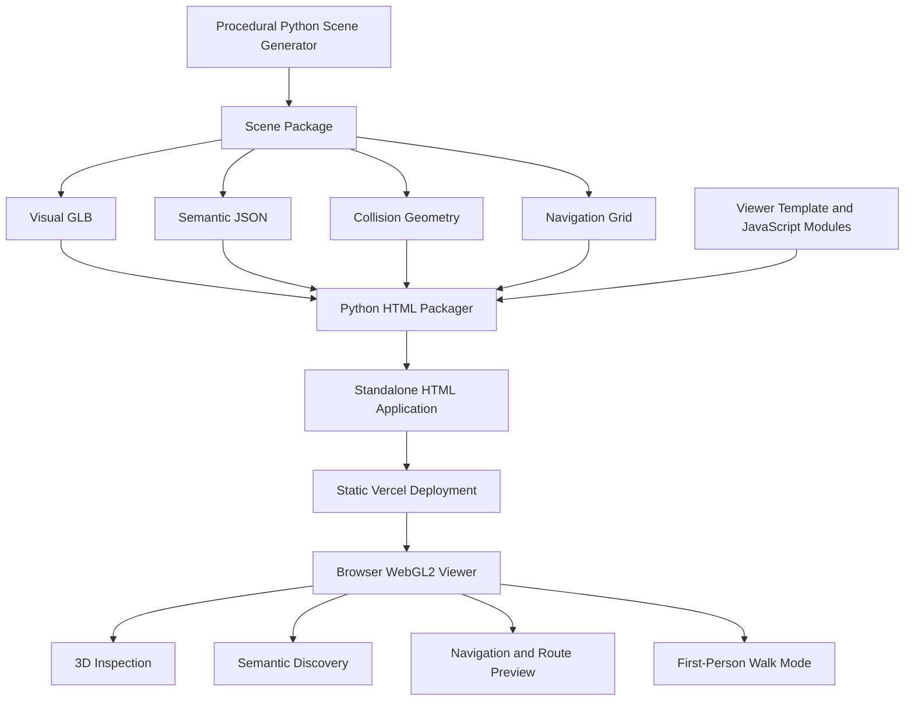

<div align="center">

# 🏛️ NAMMA TWIN

### A Browser-First Indoor Digital Twin for Spatial Inspection, Semantic Discovery, and Multi-Floor Navigation

**TECHFEST IIT BOMBAY 2026–27 · NAMMA SPACE**

**TEAM TWOPOINTERS**

[🌐 Live Application](https://namma-twin.vercel.app/) · [💻 GitHub Repository](https://github.com/tejaswee-06/Namma_Space)


*Make an indoor environment explorable—not merely viewable.*

</div>

---

## 📌 Table of Contents

- [The Product](#-the-product)
- [Live Demonstration](#-live-demonstration)
- [The Problem](#-the-problem)
- [Our Approach](#-our-approach)
- [Current Prototype Capabilities](#-current-prototype-capabilities)
- [Demonstration Environment](#-demonstration-environment)
- [Core User Experience](#-core-user-experience)
- [System Architecture](#-system-architecture)
- [Spatial Representation Model](#-spatial-representation-model)
- [Navigation and Pathfinding](#-navigation-and-pathfinding)
- [Synthetic Scan Experiment](#-synthetic-scan-experiment)
- [Real-World Reconstruction: Target Pipeline](#-real-world-reconstruction-target-pipeline)
- [Technology Stack](#-technology-stack)
- [Getting Started](#-getting-started)
- [Reproducibility and Testing](#-reproducibility-and-testing)
- [Repository Structure](#-repository-structure)
- [Deployment](#-deployment)
- [Limitations and Engineering Boundaries](#-limitations-and-engineering-boundaries)
- [Development Roadmap](#-development-roadmap)
- [Team](#-team)

---

# 🏛️ The Product

Indoor environments are difficult to understand remotely when information is distributed across photographs, static floor plans, room labels, and verbal instructions.

A photograph communicates appearance.  
A floor plan communicates layout.  
A room label communicates identity.

None of these, individually, provides an interactive spatial representation that allows a remote visitor to inspect an environment, identify locations, understand room connectivity, and navigate between destinations.

**NAMMA TWIN** explores a browser-based indoor digital twin architecture that brings these capabilities together through three independently modelled layers:

1. **Visual Geometry** — the 3D representation of the physical environment.
2. **Semantic Structure** — rooms, points of interest, doors, floors, stairs, and lifts.
3. **Navigation Geometry** — walkable regions, obstacle constraints, and inter-floor connectivity.

The central engineering principle is that these representations should remain logically independent while maintaining a consistent spatial coordinate system.

This separation enables the viewer to render a scene, interpret its spatial entities, and calculate routes without treating the visible mesh as the navigation model.

### Product Vision

```text
                INDOOR ENVIRONMENT
                        |
                        v
               SPATIAL REPRESENTATION
                        |
          +-------------+-------------+
          |             |             |
          v             v             v
     VISUAL MODEL   SEMANTIC MODEL   NAVIGATION MODEL
          |             |             |
          +-------------+-------------+
                        |
                        v
               BROWSER-BASED VIEWER
                        |
          +-------------+-------------+
          |             |             |
          v             v             v
       INSPECT        SEARCH        NAVIGATE
```

**Current implementation status:** The deployed Round 1 prototype uses a procedurally generated synthetic three-floor institutional environment named `NAMMA Demo Block A`. It is a controlled demonstration environment, not a reconstruction of a real home or building.

---

# 🌐 Live Demonstration

<div align="center">

### Explore NAMMA TWIN

[](https://namma-twin.vercel.app/)

[Direct Viewer](https://namma-twin.vercel.app/namma-twin.html)

</div>

The deployed application provides a standalone browser-based viewer.

It does not require users to install a desktop 3D application or run a local API service simply to inspect the current scene.

---

# 🚨 The Problem

Traditional indoor spatial references have several limitations.

| Traditional Representation | Limitation |
|---|---|
| Photographs | Limited spatial context and no navigable connectivity |
| Static floor plans | Do not provide immersive visual inspection |
| Room labels | Identify destinations without explaining spatial relationships |
| Manual directions | Difficult to communicate consistently across complex buildings |
| Conventional 3D models | Visual geometry alone does not guarantee valid navigation |

A useful indoor digital twin must address more than visual appearance.

It must establish consistency between:

- Geometry and physical spatial boundaries.
- Room identity and point-of-interest locations.
- Walkable surfaces and physical obstacles.
- Inter-floor connectivity and route transitions.
- Spatial coordinates and measurements.

For capture-derived environments, additional challenges include incomplete image coverage, camera registration failures, scale ambiguity, orientation drift, occlusion, reflective surfaces, and inconsistent lighting.

**The objective is therefore not simply to render a building in 3D. It is to create a spatially structured representation that supports meaningful inspection and navigation.**

---

# 💡 Our Approach

NAMMA TWIN follows a layered architecture.

### Layer 1 — Scene Generation

A Python procedural scene-generation pipeline creates the controlled synthetic environment.

It produces separate representations for:

- Visual geometry.
- Collision geometry.
- Semantic room and POI records.
- Per-floor navigation grids.
- Inter-floor portal connectivity.

### Layer 2 — Scene Packaging

A Python packaging utility combines the generated scene assets and browser viewer modules into a standalone HTML application.

### Layer 3 — Browser Rendering

The viewer uses a custom WebGL2 rendering implementation to display the environment and support interactive camera controls.

### Layer 4 — Semantic Discovery

Bundled semantic records support room and POI identification, selection, and destination lookup.

### Layer 5 — Navigation

A* search operates over walkability grids with explicit portal transitions and collision-aware route validation.

### Layer 6 — Static Deployment

The packaged viewer is published through Vercel and served directly to browsers.

---

# 🎯 Current Prototype Capabilities

| Capability | Implementation |
|---|---|
| 3D inspection | Custom WebGL2 viewer |
| Exterior inspection | Orbit camera and zoom controls |
| Multi-floor viewing | Ground, first, and second floor visibility |
| Cutaway inspection | Internal spatial inspection modes |
| Exploded view | Spatial layer inspection |
| Floor-plan view | Floor-specific layout inspection |
| Semantic search | Room and POI records |
| Destination selection | Semantic location selection |
| Pathfinding | 8-connected A* |
| Inter-floor navigation | Explicit stair and lift portals |
| Step-free routing | Lift-constrained routing |
| Collision validation | Route checks against authored obstacles |
| Walk mode | First-person camera interaction |
| Static packaging | Standalone HTML artifact |
| Deployment | Vercel static hosting |

## Engineering Differentiators

### 1. Geometry Is Not Navigation

A rendered mesh is not automatically a valid walking surface.

NAMMA TWIN maintains separate collision and navigation representations so that visual appearance does not determine route validity.

### 2. Semantics Are Explicit Data

Rooms, POIs, doors, stairs, and lifts are represented as structured records.

This allows spatial entities to be searched and selected independently of their rendered appearance.

### 3. Navigation Fails Closed

When a destination is unmapped, blocked, or disconnected, the route planner can return a no-path result rather than inventing a route.

### 4. Modular Scene Replacement

The viewer consumes a packaged scene representation.

This allows a future scene package to replace the current synthetic environment without requiring the browser interaction layer to be rewritten.

### 5. Provenance-Aware Evaluation

Synthetic scene-generation statistics and simulated scan results are distinguished from real-world reconstruction measurements.

---

# 🏢 Demonstration Environment

The current prototype uses **NAMMA Demo Block A**, a procedurally generated three-floor institutional environment.

The environment contains:

- Entrance lobby and reception.
- Seminar and conference spaces.
- Administrative offices.
- Student commons and café.
- Teaching and research laboratories.
- Faculty and department offices.
- Library and reading areas.
- Washrooms.
- Staircases and lift cores.

## Scene Statistics

The following values are taken from the committed synthetic scene build statistics.

| Parameter | Value |
|---|---:|
| Floors | 3 |
| Room records | 30 |
| POI records | 29 |
| Collider volumes | 668 |
| Visual meshes | 155 |
| Visual triangles | 51,708 |
| Visual materials | 41 |
| Textures | 7 |
| Collision meshes | 588 |
| Collision triangles | 7,056 |

The authored environment uses a 36 m × 20 m footprint, a 3.6 m floor-to-floor interval, and a Y-up local coordinate convention.

These values describe the synthetic scene specification. They are not measurements of a surveyed physical building.

---

# 🧭 Core User Experience

## 1. Exterior Inspection

Users can orbit around the generated environment to understand its overall structure.

Available interactions include:

- Camera rotation.
- Zoom.
- Pan.
- Object selection.
- Floor visibility controls.

## 2. Multi-Floor Exploration

The building contains three independently selectable floors.

Users can isolate a floor to inspect its internal layout without navigating through the entire structure.

## 3. Cutaway and Exploded Views

Spatial inspection modes expose the internal arrangement of the environment.

These views help users understand the relationship between floors, rooms, corridors, and vertical circulation.

## 4. Semantic Room and POI Discovery

The viewer uses bundled semantic records to identify rooms and points of interest.

Example locations include:

- Main Entrance.
- Entrance Lobby & Reception.
- Student Commons & Cafe.
- Electronics Lab 1.
- Telecommunications Lab.
- Library & Reading Room.
- Conference Room.
- Lift and Staircase A.

## 5. Route Preview

Users can select a destination and request a route through the authored navigation model.

The route planner considers:

- Walkable cells.
- Obstacle masks.
- Floor connectivity.
- Stair transitions.
- Lift transitions.
- Destination reachability.

## 6. First-Person Walk Mode

Walk mode provides a more direct way to inspect the generated environment.

| Input | Action |
|---|---|
| `W` | Move forward |
| `A` | Move left |
| `S` | Move backward |
| `D` | Move right |
| Arrow keys | Directional movement |
| Pointer movement | Look around |
| Floor click | Move toward a selected walkable location |
| `E` | Use an available stair or lift transition |

### Recommended Demonstration Sequence

```text
OPEN EXTERIOR VIEW
        |
        v
SELECT A FLOOR
        |
        v
INSPECT CUTAWAY
        |
        v
SEARCH FOR A ROOM
        |
        v
SELECT A POI
        |
        v
PREVIEW THE ROUTE
        |
        v
CHECK FLOOR TRANSITIONS
        |
        v
ENTER WALK MODE
```

---

# 🏗️ System Architecture

The current architecture separates the implemented viewer from the experimental scan simulator and the planned real-capture pipeline.

## Implemented Architecture



## Architecture Components

| Component | Responsibility |
|---|---|
| Procedural Scene Builder | Generates the synthetic environment |
| Visual GLB | Stores renderable geometry |
| Semantic JSON | Stores rooms, floors, POIs and connectivity records |
| Collision Geometry | Represents obstacles and collision constraints |
| Navigation Grid | Stores walkability and portal information |
| HTML Packager | Creates the standalone viewer |
| Browser Renderer | Displays the scene using WebGL2 |
| Navigation Engine | Calculates and validates routes |
| Vercel | Hosts the static application |

## Representation Layers

```text
                   SCENE PACKAGE
                        |
          +-------------+-------------+
          |             |             |
          v             v             v
      VISUAL        SEMANTIC       NAVIGATION
      GEOMETRY       STRUCTURE      GEOMETRY
          |             |             |
          v             v             v
       visual.glb   semantic.json  navgrid.json
          |             |             |
          +-------------+-------------+
                        |
                        v
                  BROWSER VIEWER
                        |
          +-------------+-------------+
          |             |             |
          v             v             v
       RENDER         SEARCH        ROUTING
```

---

# 🧱 Spatial Representation Model

The project maintains separate spatial representations to avoid coupling navigation behaviour to visual rendering.

## Visual Layer

The visual layer contains the generated building geometry, material definitions, and textures.

Its purpose is to provide the rendered representation used for remote inspection.

## Semantic Layer

The semantic layer contains structured information about:

- Floors.
- Rooms.
- POIs.
- Doors.
- Staircases.
- Lifts.
- Room labels.
- Spatial associations.

## Collision Layer

The collision layer contains obstacle geometry and collider information used to validate movement and route clearance.

## Navigation Layer

The navigation layer contains floor-specific walkability grids and the explicit portal graph connecting floors.

This separation allows each representation to be inspected and tested independently.

---

# 🗺️ Navigation and Pathfinding

The navigation model is separate from the visible scene mesh.

The current Python navigation implementation uses:

1. Per-floor walkability grids.
2. Obstacle masks derived from collider bounds.
3. Eight-connected A* search within a floor.
4. Explicit stair and lift portal transitions.
5. Line-of-sight route smoothing.
6. Final route revalidation against the authored navigation and collision representation.

## A* Search

A* estimates the cost of reaching the destination using:

\[
f(n)=g(n)+h(n)
\]

Where:

- \(g(n)\) is the accumulated path cost.
- \(h(n)\) is the estimated remaining cost.
- \(f(n)\) is the total estimated route cost.

The search operates on walkable cells rather than arbitrary rendered triangles.

## Inter-Floor Navigation

The portal graph models transitions between floors through explicit connections.

Stairs and lifts are represented as different transition types, enabling constrained routing.

## Route Validation

Candidate routes are checked against the authored walkability and collision representation.

The planner is designed to reject invalid or disconnected paths rather than silently creating paths through obstacles.

## Test Results

The current navigation test suite contains 13 tests and passed **13/13** on the authored synthetic scene.

Test coverage includes:

- Same-floor routing.
- POI reachability.
- Multi-floor navigation.
- Lift-constrained routing.
- Blocked corridors.
- Unmapped destinations.
- Sealed doors.
- Alternate path generation.
- Obstacle clearance.
- Stair and lift constraints.

These results demonstrate software behaviour on the synthetic environment. They do not certify navigation safety in a real building.

---

# 🧪 Synthetic Scan Experiment

A separate experimental module simulates camera trajectories, visibility, noisy observations, feature tracks, and point-cloud generation using the procedurally authored scene.

The experiment is intended to investigate viewpoint coverage and registration-related behaviour in a controlled environment.

**It is not a real smartphone capture and is not a COLMAP reconstruction.**

## Recorded Experiment Values

| Parameter | Recorded Result |
|---|---:|
| Virtual frames generated | 604 |
| Frames marked registered | 445 |
| Registration proportion | 73.7% |
| Candidate surface samples | 3,000,000 |
| Feature points retained | 1,315,421 |
| Triangulated point estimates | 453,196 |
| Dense point set after thinning | 370,496 |
| Mean room-floor coverage | 37.9% |
| Simulation runtime | 237.1 seconds |

The 37.9% mean room-floor coverage is treated as a limitation signal.

The simulator uses a known synthetic reference environment. Its residuals and point-cloud statistics cannot establish the accuracy of a real-image reconstruction system.

The report explicitly records:

```json
{
  "is_real_site_capture": false,
  "is_colmap_output": false
}
```

## Run the Synthetic Experiment

```bash
python -m reconstruction.synthetic.simulate_scan --scene assets/scenes/demo-block-a --cand 3000000
```

The experiment writes its outputs under:

```text
assets/scenes/demo-block-a/scan/
```

## Run the Registration Demonstration

```bash
python -m reconstruction.registration.run_demo
```

The registration demonstration uses the known synthetic environment for its reference geometry. It does not establish real-world metric registration accuracy.

---

# 📷 Real-World Reconstruction: Target Pipeline

The intended product direction is to transform ordinary smartphone imagery into a structured, navigable indoor environment.

The real-capture pipeline remains a target validation path and has not been validated on real indoor footage in the current Round 1 prototype.

```mermaid
flowchart LR

    A["Smartphone Photos / Video"]

    --> B["Capture SOP and Frame QA"]

    --> C["Keyframe Selection"]

    --> D["SfM / MVS Reconstruction"]

    --> E["Scale and Gravity Alignment"]

    --> F["Geometry Processing"]

    --> G["Room and POI Semantics"]

    --> H["Collision and Walkability"]

    --> I["GLB and JSON Scene Package"]

    --> J["Browser Digital Twin"]
```



## Target Processing Stages

| Stage | Intended operation |
|---|---|
| Capture | Record overlapping indoor walkthrough footage |
| Frame QA | Identify blur, exposure issues and insufficient overlap |
| Keyframe Selection | Select frames with useful visual coverage |
| SfM | Estimate camera poses and sparse geometry |
| MVS | Generate a denser geometric representation |
| Metric Alignment | Recover scale and gravity-aligned orientation |
| Geometry Processing | Interpret surfaces and spatial boundaries |
| Semantic Processing | Assign room and POI identities |
| Navigation Processing | Derive obstacles and walkability |
| Scene Packaging | Produce viewer-compatible GLB and JSON assets |

This pipeline requires validation against independent physical measurements and site observations before reconstruction accuracy or real-world navigation performance can be claimed.

---

# ⚙️ Technology Stack

## Scene Generation and Geometry

- Python
- NumPy
- SciPy
- Pillow
- Procedural geometry generation
- glTF / GLB

## Browser Application

- HTML
- CSS
- Vanilla JavaScript
- Custom WebGL2 renderer

## Spatial Computing

- Walkability grids
- Collider geometry
- A* pathfinding
- Portal graph
- Coordinate-frame registration utilities
- Synthetic point-cloud experiments

## Packaging and Deployment

- Python packaging utilities
- Standalone HTML application
- GitHub
- Vercel

**Note:** The current viewer is not a Next.js, React, Three.js, or FastAPI deployment. The README describes the actual shipped implementation.

---

# 🚀 Getting Started

## Prerequisites

For the prebuilt viewer:

- Python 3
- A modern browser
- WebGL2 support

For rebuilding the synthetic scene:

- Python 3.10+
- pip

## 1. Clone the Repository

```bash
git clone https://github.com/tejaswee-06/Namma_Space.git

cd Namma_Space
```

## 2. Run the Existing Viewer

The quickest way to run NAMMA TWIN is to serve the prebuilt standalone HTML application.

### Windows PowerShell

```powershell
py -m http.server 8000
```

### macOS / Linux

```bash
python3 -m http.server 8000
```

Open your browser:

```text
http://localhost:8000/dist/namma-twin.html
```

The viewer is packaged as a standalone HTML application. Node.js and npm are not required to run this prebuilt viewer.

## 3. Create a Python Virtual Environment

To regenerate the synthetic scene:

```bash
python -m venv .venv
```

### Windows PowerShell

```powershell
.\.venv\Scripts\Activate.ps1
```

### macOS / Linux

```bash
source .venv/bin/activate
```

## 4. Install Dependencies

```bash
python -m pip install --upgrade pip

python -m pip install numpy scipy pillow pytest
```

## 5. Generate the Synthetic Environment

```bash
python -m reconstruction.synthetic.build_building --out assets/scenes/demo-block-a
```

## 6. Run the Synthetic Scan Experiment

```bash
python -m reconstruction.synthetic.simulate_scan --scene assets/scenes/demo-block-a --cand 3000000
```

## 7. Run Registration Demonstration

```bash
python -m reconstruction.registration.run_demo
```

## 8. Package the Browser Viewer

```bash
python -m tools.pack_viewer --scene assets/scenes/demo-block-a --out dist
```

## 9. Start the Viewer

```bash
py -m http.server 8000
```

Open:

```text
http://localhost:8000/dist/namma-twin.html
```

---

# 🧪 Reproducibility and Testing

Run the navigation tests:

```bash
python -m pytest reconstruction/tests/test_navigation.py -v
```

The committed navigation suite has passed 13 out of 13 tests on the authored synthetic scene.

The test suite checks route generation and validation against the supplied environment.

Re-running the tests on modified scene assets may produce different results.

## Synthetic Experiment Reproducibility

The synthetic scan report is stored alongside the scan experiment outputs.

For reproducible inspection, retain:

- Scene build statistics.
- Synthetic scan report.
- Camera metadata.
- Point-cloud outputs.
- Registration report.
- Navigation test results.

Do not interpret synthetic residuals as independent real-world measurements.

---

# 📁 Repository Structure

```text
NAMMA-TWIN/
│
├── .github/
│
├── apps/
│
├── assets/
│   ├── reference/
│   └── scenes/
│       └── demo-block-a/
│           ├── visual.glb
│           ├── collision.glb
│           ├── semantic.json
│           ├── colliders.json
│           ├── navgrid.json
│           ├── build_stats.json
│           └── scan/
│
├── blender/
│
├── database/
│
├── dist/
│   ├── index.html
│   └── namma-twin.html
│
├── docker/
│
├── docs/
│   ├── competition/
│   └── media/
│
├── reconstruction/
│   ├── synthetic/
│   ├── registration/
│   ├── navigation_geometry/
│   └── tests/
│
├── scripts/
│
├── tools/
│   ├── pack_viewer.py
│   └── render_glb.py
│
├── viewer/
│   ├── template.html
│   └── js/
│       ├── 10_core.js
│       ├── 20_gl.js
│       ├── 30_nav.js
│       ├── 40_app.js
│       └── 50_ui.js
│
└── README.md
```

---

# ☁️ Deployment

The current standalone browser viewer is deployed using Vercel.

### Live Application

**Main URL:**

https://namma-twin.vercel.app/

**Direct Viewer:**

https://namma-twin.vercel.app/namma-twin.html

### Deployment Configuration

| Setting | Value |
|---|---|
| Framework | Other |
| Root Directory | `./` |
| Build Command | Empty |
| Install Command | Empty |
| Output Directory | `dist` |

The `dist/index.html` file redirects the root application URL to the standalone viewer.

### Automatic Deployment

The project is connected to GitHub.

Push an update to the production branch:

```bash
git add .

git commit -m "Update NAMMA TWIN"

git push origin main
```

Vercel automatically publishes the updated static output when the connected Git integration is configured for production deployments.

---

# ⚠️ Limitations and Engineering Boundaries

The current Round 1 implementation is deliberately scoped.

The following capabilities are not claimed as completed:

- No real indoor smartphone photo/video capture is included in the submitted scene.
- No production SfM/MVS reconstruction from real user footage is integrated into the deployed viewer.
- The synthetic scan simulator is not COLMAP.
- No real-site metric accuracy has been established.
- No real-world reconstruction completeness has been measured.
- No production automatic room or object recognition is included.
- No production capture-upload backend or asynchronous reconstruction service is deployed.
- No AR navigation is included in the current prototype.
- Navigation tests do not certify safe movement in a physical building.
- Real-device frame-rate and loading benchmarks have not been established.

These boundaries are documented to distinguish demonstrated software functionality from the remaining work required for a capture-derived indoor digital twin.

---

# 🛣️ Development Roadmap

| Workstream | Engineering Objective |
|---|---|
| Capture | Execute a repeatable smartphone walkthrough procedure |
| Frame Quality | Assess blur, exposure and spatial coverage |
| Reconstruction | Validate SfM/MVS on real indoor footage |
| Metric Registration | Align scale and gravity using reference measurements |
| Semantic Processing | Identify and annotate rooms, doors and POIs |
| Spatial Navigation | Derive walkable regions and obstacle geometry |
| Viewer Integration | Replace synthetic assets with capture-derived scene packages |
| Performance | Measure load time and interaction performance on representative devices |
| AR Extension | Investigate live phone-based spatial guidance |

Each stage requires independent validation before being treated as an established product capability.

---

# 👥 Team TWOPOINTERS

| Member | Role |
|---|---|
| **Tejaswee Rajput** | Team Lead |
| **Sohana Pilli** | Team Member |
| **Rahul Sharma** | Team Member |

**Competition:** Namma Space  
**Institution:** Techfest, IIT Bombay  
**Edition:** 2026–27

---

<div align="center">

# 🏛️ NAMMA TWIN

### Explore the space. Understand the structure. Navigate with constraints.

[🌐 Open Live Application](https://namma-twin.vercel.app/)

[💻 Explore Source Code](https://github.com/tejaswee-06/Namma_Space)

**Built by Team TWOPOINTERS**

</div>
